# Laboratorio 14 — Despliegue en Producción (GuateGanado)

> **Curso:** IF0009 · **Proyecto:** GuateGanado (Sistema de Gestión Ganadera)  
> **Repositorios:** [`Haki7w7/ProyectoGanadero_BackEnd`](https://github.com/Haki7w7/ProyectoGanadero_BackEnd) (API Laravel) y [`JoelSotela-hub/ProyectoGanadero_FrontEnd`](https://github.com/JoelSotela-hub/ProyectoGanadero_FrontEnd) (Web SPA + App Móvil Android)  
> **Insignias de CI:**  
> 
> 

---

## 1. Arquitectura de Despliegue

El sistema se despliega bajo una arquitectura distribuida de 6 piezas utilizando servicios administrados con HTTPS obligatorio. Ni la aplicación web ni la aplicación móvil acceden directamente a la base de datos: toda comunicación se realiza mediante tokens Bearer (Laravel Sanctum) contra la API REST pública, que es el único componente con credenciales de conexión hacia Aiven for MySQL.

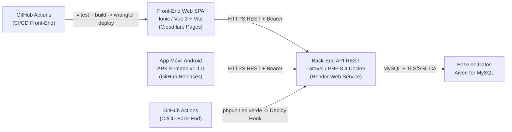

| Pieza | Servicio / Plataforma | Configuración Principal | Límite / Nota Operativa |
| --- | --- | --- | --- |
| **API REST (Back-End)** | Render (Web Service Docker) | Imagen multi-etapa `serversideup/php:8.4-fpm-nginx`, puerto `8080`, healthcheck `/up`, `Auto-Deploy: Off` | Plan Free (512 MB RAM); se suspende tras 15 min sin tráfico y despierta en ~1 min |
| **Base de Datos** | Aiven for MySQL | MySQL gestionado, TLS/SSL obligatorio (`certs/aiven-ca.pem`), `sql_require_primary_key = ON` | Plan Free (1 GB RAM / 1 GB disco); puede apagarse por inactividad prolongada |
| **Front-End Web SPA** | Cloudflare Pages | Proyecto `guateganado` (`https://guateganado.pages.dev`), `npm run build` → `dist/`, `NODE_VERSION=22`, enrutamiento SPA sin `404.html` | Despliegue automático en `push` a `main` mediante `wrangler-action` desde GitHub Actions; 500 builds/mes |
| **App Móvil (Android)** | GitHub Releases (APK) | Ionic/Capacitor sincronizado con el build de producción (`appId: cr.guateganado.app`), firmado con keystore `.jks` (`v1.1.0`, `guateganado-v1.1.0.apk`) | Distribución directa por APK firmado (sin Google Play) |
| **CI/CD Back-End** | GitHub Actions | `php artisan test` (SQLite en memoria, 20 archivos de pruebas) + `RENDER_DEPLOY_HOOK` condicional en `main` | Una prueba en rojo detiene el job `deploy` |
| **CI/CD Front-End** | GitHub Actions | `npm run test:unit` (Vitest, 8 archivos / 46 pruebas), `npm run build` (`vue-tsc && vite build`) y `cloudflare/wrangler-action@v3` (`pages deploy dist --project-name=guateganado --branch=main`) condicional en `push` a `main` | Valida PRs y commits; publica automáticamente al fusionar a `main` |

> **Nota sobre estructura multi-repositorio:** A diferencia de un monorepo con carpetas `backend/`, `web/` y `movil/`, el equipo mantiene dos repositorios independientes (`Haki7w7/ProyectoGanadero_BackEnd` y `JoelSotela-hub/ProyectoGanadero_FrontEnd`, donde este último empaqueta tanto la SPA web como la app móvil Capacitor). Este documento se mantiene sincronizado en `docs/lab14-despliegue.md` en ambos repositorios para garantizar trazabilidad completa.

---

## 2. Separación de Entornos y Variables de Configuración (Sin Secretos)

La separación entre desarrollo y producción se garantiza mediante inyección de variables en cada plataforma y exclusión estricta de archivos sensibles en `.gitignore` y `.dockerignore`:

- Ninguna contraseña, llave de cifrado (`APP_KEY`), token, archivo `.env` ni almacén de firma (`.jks`) se versiona en el repositorio.
- El único archivo relacionado con TLS versionado en el Back-End es el certificado público de autoridad certificadora (`certs/aiven-ca.pem`).
- **Falla explícita (*Fail-Fast*):** En `AppServiceProvider::boot()`, cuando `APP_ENV=production` y la aplicación no se ejecuta por consola, Laravel lanza una `RuntimeException` si falta `APP_KEY`, `DB_HOST` o `CORS_ALLOWED_ORIGINS`, o si `CORS_ALLOWED_ORIGINS` incluye un comodín `*`.

### 2.1 Back-End (Render — Web Service)

| Variable | Ejemplo / Valor Referencial | Tipo | Descripción |
| --- | --- | --- | --- |
| `APP_NAME` | `GuateGanado` | Config | Nombre de la aplicación |
| `APP_ENV` | `production` | Config | Activa optimizaciones y validaciones fail-fast |
| `APP_DEBUG` | `false` | Config | Evita exponer trazas de error y variables en respuestas HTTP |
| `APP_KEY` | `base64:<oculto-en-render>` | **Secreto** | Llave de cifrado de Laravel configurada como secreto en Render |
| `APP_URL` | `https://proyectoganadero-backend.onrender.com` | Config | URL pública HTTPS de la API |
| `PORT` | `8080` | Config | Puerto en el que escucha Nginx/PHP-FPM dentro del contenedor |
| `LOG_CHANNEL` | `stderr` | Config | Dirige los logs al panel de Render |
| `SESSION_DRIVER` | `database` | Config | Evita pérdida de estado ante disco efímero del contenedor |
| `CACHE_STORE` | `database` | Config | Persiste caché fuera del sistema de archivos efímero |
| `QUEUE_CONNECTION` | `sync` | Config | Ejecución síncrona compatible con el plan gratuito sin workers |
| `DB_CONNECTION` | `mysql` | Config | Driver MySQL hacia Aiven |
| `DB_HOST` | `mysql-2c0b7f04-kevinrugama1711.c.aivencloud.com` | Config | Host de la instancia Aiven for MySQL |
| `DB_PORT` | `15889` | Config | Puerto TLS de Aiven |
| `DB_DATABASE` | `defaultdb` | Config | Base de datos principal |
| `DB_USERNAME` | `avnadmin` | **Secreto** | Usuario de conexión |
| `DB_PASSWORD` | `************` *(oculto en Render/Aiven)* | **Secreto** | Contraseña de conexión hacia Aiven for MySQL |
| `MYSQL_ATTR_SSL_CA` | `/var/www/html/certs/aiven-ca.pem` | Config | Ruta interna al certificado CA de Aiven |
| `CORS_ALLOWED_ORIGINS` | `https://guateganado.pages.dev,http://localhost,https://localhost,capacitor://localhost,http://localhost:8100` | Config | Lista explícita de orígenes permitidos (web + Capacitor Android HTTP/HTTPS + iOS + desarrollo; nunca `*`) |

### 2.2 Front-End Web (GitHub Actions / Cloudflare Pages)

| Variable | Ejemplo / Valor Referencial | Descripción |
| --- | --- | --- |
| `NODE_VERSION` | `22` | Versión de Node.js configurada para la compilación (`setup-node@v4` en CI) |
| `VITE_API_URL` | `https://proyectoganadero-backend.onrender.com` | URL base pública de la API fijada en tiempo de compilación (sin sufijo `/api/v1` ni secretos; `src/services/http.ts` agrega `/api/v1` o `/api/user` automáticamente) |

### 2.3 Secretos de CI/CD (GitHub Actions)

| Repositorio | Secreto | Descripción |
| --- | --- | --- |
| `Haki7w7/ProyectoGanadero_BackEnd` | `RENDER_DEPLOY_HOOK` | URL secreta de despliegue en Render invocada solo cuando el job `api` aprueba en `main` |
| `JoelSotela-hub/ProyectoGanadero_FrontEnd` | `CLOUDFLARE_API_TOKEN` | Token de API de Cloudflare usado por `cloudflare/wrangler-action@v3` para publicar `dist/` en el proyecto `guateganado` |
| `JoelSotela-hub/ProyectoGanadero_FrontEnd` | `CLOUDFLARE_ACCOUNT_ID` | ID de cuenta de Cloudflare Pages para el despliegue automático desde `main` |

---

## 3. Empaquetado, Contenerización y Seguridad

### 3.1 Contenedor Multi-Stage del Back-End (`Dockerfile`)

- **Etapa 1 (`vendor`):** Instala únicamente dependencias de producción (`composer install --no-dev --no-scripts --no-autoloader --no-interaction --prefer-dist`) y compila el autoloader optimizado (`composer dump-autoload --optimize --no-dev`).
- **Etapa 2 (imagen final):** Parte de `serversideup/php:8.4-fpm-nginx` con `PHP_OPCACHE_ENABLE=1` y `AUTORUN_ENABLED=true` (ejecuta `migrate --force`, `storage:link` y cachés de configuración/rutas/vistas al iniciar). Copia únicamente el código necesario y `vendor/` desde la etapa anterior con propietario `--chown=www-data:www-data`.
- **Usuario sin privilegios:** El contenedor se ejecuta bajo `USER www-data` (no `root`) y expone el puerto `8080`.
- **Contexto depurado (`.dockerignore`):** Excluye `.env`, `.git`, `.github`, `node_modules`, `vendor`, `tests`, `docs`, `backend-aspnet`, `backend-nestjs`, `*.sqlite*`, cachés/logs locales y `api.json`.

### 3.2 Endurecimiento de Producción

- **Proxies de confianza:** `$middleware->trustProxies(at: '*')` en `bootstrap/app.php` para que los enlaces generados y de paginación utilicen `https://` detrás del proxy inverso de Render.
- **CORS restrictivo:** `config/cors.php` lee dinámicamente `CORS_ALLOWED_ORIGINS` (separados por coma) y mantiene `supports_credentials => false`, dado que se emplea autenticación por token Bearer (Sanctum) entre dominios distintos (`https://guateganado.pages.dev`, `https://proyectoganadero-backend.onrender.com` y `http://localhost` / `https://localhost` en Android, ya que `capacitor.config.ts` define `androidScheme: 'http'`).
- **Seguridad de registro:** Se deshabilitó el registro público de cuentas; la creación de nuevos perfiles (`POST /api/v1/auth/register`) está restringida exclusivamente al rol `admin` autenticado.
- **Almacenamiento seguro móvil:** El token de sesión en Android continúa resguardado en almacenamiento seguro del dispositivo, y el archivo `.jks` de firma se conserva fuera del repositorio.
- **Manejo de disco efímero:** Debido a que el contenedor de Render descarta archivos locales en cada redespliegue, se eliminó la carga de fotografías locales en el módulo de animales y se configuraron sesiones/caché en base de datos (`database`).

### 3.3 Tamaño de los Artefactos Generados

| Artefacto | Repositorio | Comando de Medición | Tamaño Medido | Notas |
| --- | --- | --- | --- | --- |
| **Imagen Docker Back-End** (`Dockerfile` multi-stage) | `Haki7w7/ProyectoGanadero_BackEnd` | `docker images guateganado-api` | `204 MB (Content Size) / 839 MB (Disk Usage)` | Imagen `guateganado-api:latest` (`54e667fd4675`, `serversideup/php:8.4-fpm-nginx` sin dependencias dev) |
| **Build Front-End Web** (`dist/`) | `JoelSotela-hub/ProyectoGanadero_FrontEnd` | `(Get-ChildItem -Recurse -File dist \| Measure-Object Length -Sum).Sum / 1MB` / `du -sh dist/` | `3.51 MB (3,681,252 bytes; 147 archivos)` | Bundle optimizado por `vue-tsc && vite build` (sin `404.html`) |
| **APK Android Firmado (`v1.1.0`)** | `JoelSotela-hub/ProyectoGanadero_FrontEnd` | `Get-Item android\app\release\guateganado-v1.1.0.apk` / `ls -lh` | `28.06 MB (29,419,519 bytes)` | Release `guateganado-v1.1.0.apk` firmado y publicado en GitHub Releases |

---

## 4. Direcciones Públicas y Verificación del Despliegue

### 4.1 Enlaces en Producción

- **Front-End Web SPA (Cloudflare Pages):** `https://guateganado.pages.dev`
- **API REST (Render):** `https://proyectoganadero-backend.onrender.com`
- **Healthcheck API (`/up`):** `https://proyectoganadero-backend.onrender.com/up`
- **Release App Móvil Android (`v1.1.0`):** `https://github.com/JoelSotela-hub/ProyectoGanadero_FrontEnd/releases/tag/v1.1.0`
- **Repositorio Back-End:** `https://github.com/Haki7w7/ProyectoGanadero_BackEnd`
- **Repositorio Front-End:** `https://github.com/JoelSotela-hub/ProyectoGanadero_FrontEnd`

### 4.2 Verificación de Estado, HTTPS y Protección de Rutas

Comandos ejecutados contra el entorno público de producción:

```powershell
# 1. Verificación de salud (esperado: HTTP 200)
# Nota: En Windows PowerShell usar `curl.exe` (ya que `curl` sin .exe es un alias de Invoke-WebRequest)
curl.exe -i https://proyectoganadero-backend.onrender.com/up

# 2. Verificación de ruta protegida sin token (esperado: HTTP 401 Unauthorized)
curl.exe -i https://proyectoganadero-backend.onrender.com/api/v1/animales
```

**Resultado observado:**

```text
# 1) GET https://proyectoganadero-backend.onrender.com/up
HTTP/1.1 200 OK
Date: Mon, 23 Nov 2026 00:47:22 GMT
Content-Type: text/html; charset=utf-8
Transfer-Encoding: chunked
Connection: keep-alive
Cache-Control: no-cache, private
cf-cache-status: DYNAMIC
referrer-policy: strict-origin-when-cross-origin
rndr-id: 873be593-65d9-4a37
Server: cloudflare
strict-transport-security: max-age=31536000; includeSubDomains
vary: Accept-Encoding
x-content-type-options: nosniff
x-frame-options: SAMEORIGIN
x-render-origin-server: nginx
CF-RAY: a5ec29875b4f167c-TPA
alt-svc: h3=":443"; ma=86400

<!DOCTYPE html> ... <title>GuateGanado</title> ... Application up — HTTP request received. Response rendered in 6ms.

# 2) GET https://proyectoganadero-backend.onrender.com/api/v1/animales
HTTP/1.1 401 Unauthorized
Date: Mon, 23 Nov 2026 00:47:23 GMT
Content-Type: application/json
Transfer-Encoding: chunked
Connection: keep-alive
Cache-Control: no-cache, private
cf-cache-status: DYNAMIC
referrer-policy: strict-origin-when-cross-origin
rndr-id: ddfff453-5131-41c1
Server: cloudflare
strict-transport-security: max-age=31536000; includeSubDomains
vary: Origin
vary: Accept-Encoding
x-content-type-options: nosniff
x-frame-options: SAMEORIGIN
x-render-origin-server: nginx
CF-RAY: a5ec298ddf0fb207-MIA
alt-svc: h3=":443"; ma=86400

{"error":"No autenticado","mensaje":"Debe autenticarse para acceder a este recurso."}
```

- **Certificado TLS/HTTPS:** Válido y emitido automáticamente tanto en `*.onrender.com` como en `*.pages.dev` (HSTS habilitado: `strict-transport-security: max-age=31536000; includeSubDomains`).
- **Migraciones y datos en producción:** Ejecutadas contra Aiven for MySQL con certificado SSL (`aiven-ca.pem`) y datos iniciales verificados desde la aplicación web y móvil.
- **Exposición de secretos:** `APP_DEBUG=false` verificado; ante errores o accesos no autorizados no se exponen trazas ni variables de entorno.

**Evidencia visual del entorno desplegado:**

- **Aplicación Web en Cloudflare Pages (HTTPS válido y sesión activa):**  
  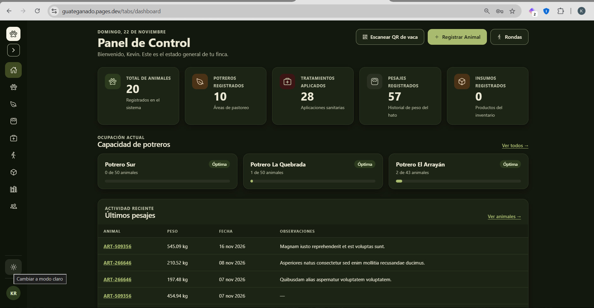
- **Healthcheck `/up` (200) y endpoint protegido (401) + Panel de Render Live:**  
  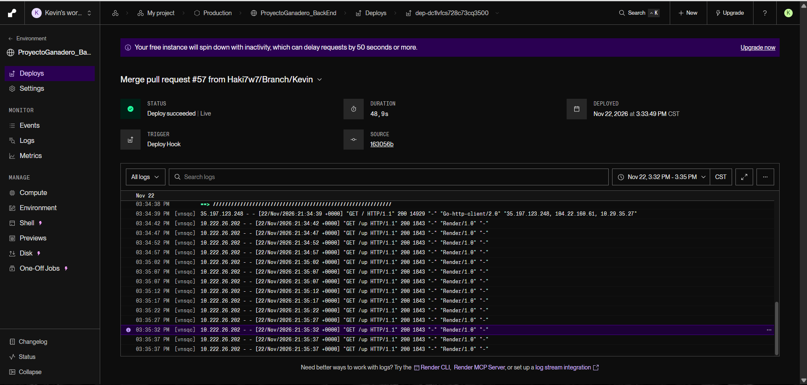
- **Base de datos MySQL en estado Running (Aiven):**  
  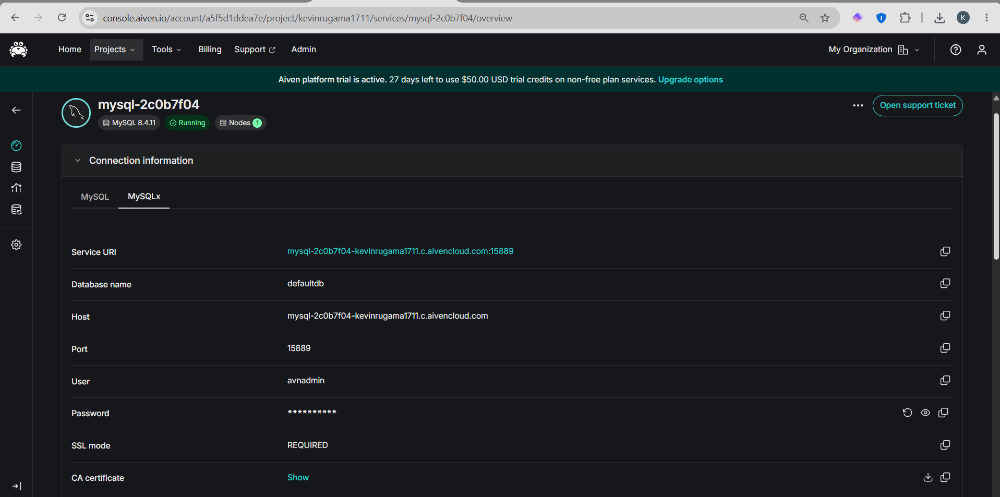

---

## 5. Integración y Entrega Continuas (CI/CD)

### 5.1 Flujo Automatizado

- **Back-End (`.github/workflows/ci.yml`):** En cada `push` a `main` y `pull_request`, levanta PHP 8.4 con `pdo_sqlite` y `mbstring`, instala dependencias, genera configuración aislada de prueba y ejecuta `php artisan test` (**20 archivos de pruebas**) sobre SQLite en memoria (sin tocar la base de Aiven). El job `deploy` (`needs: [api]`) dispara `RENDER_DEPLOY_HOOK` únicamente si `event_name == 'push'`, la rama es `main` y todas las pruebas aprueban.
- **Front-End (`.github/workflows/ci.yml`):** En cada `push` a `main` y `pull_request`, instala dependencias con Node 22 (`npm ci`), ejecuta la suite unitaria Vitest (**8 archivos / 46 pruebas**) y compila producción (`npm run build` → `vue-tsc && vite build`). Cuando `event_name == 'push'` en `refs/heads/main` y ambos pasos aprueban, ejecuta `Deploy to Cloudflare Pages` mediante `cloudflare/wrangler-action@v3` (`pages deploy dist --project-name=guateganado --branch=main`). *(Nota: `npm run lint` se valida localmente antes de subir cambios, no como paso del workflow actual).*

### 5.2 Evidencia de Ejecución Exitosa (Verde)

- **Workflow run exitoso (Back-End — Tests + Deploy Hook):** `https://github.com/Haki7w7/ProyectoGanadero_BackEnd/actions/runs/45072759729` *(push a `main`; `API Tests (Laravel / PHP 8.4)`: `success` → `Trigger Render Deploy`: `success`)*  
  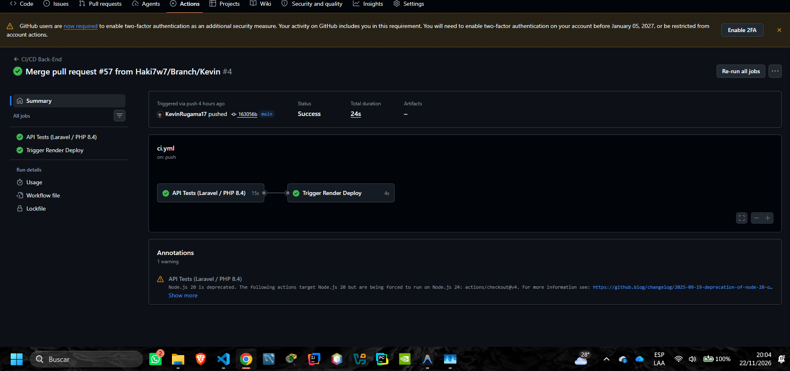
- **Workflow run exitoso (Front-End — Tests + Build + Deploy):** `https://github.com/JoelSotela-hub/ProyectoGanadero_FrontEnd/actions/runs/45087479438` *(push a `main`; Vitest `8 passes / 46 passes`, `Build production bundle` y `Deploy to Cloudflare Pages`: `success`)*  
  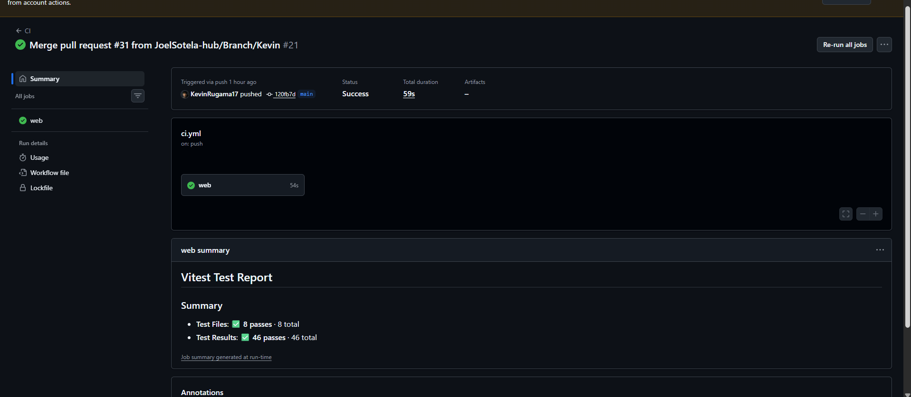  
  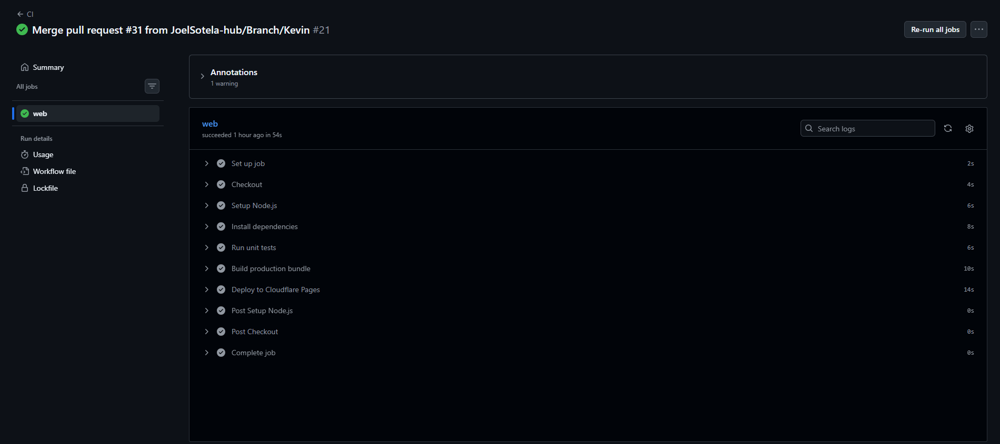

### 5.3 Evidencia de Detención por Prueba Fallida (Rojo)

Para comprobar que el pipeline protege el entorno de producción, se ejecutó un caso con fallo controlado en la suite de pruebas verificando que el job de pruebas falló en rojo (`failure`) y el job de compilación/despliegue (`Trigger Render Deploy` / `Build production bundle`) quedó omitido (`skipped`), manteniendo intacta la versión previa en producción:

- **Workflow run detenido por fallo (Back-End — `deploy` omitido):** `https://github.com/Haki7w7/ProyectoGanadero_BackEnd/actions/runs/45099271836` *(`API Tests (Laravel / PHP 8.4)`: `failure` → `Trigger Render Deploy`: `skipped`)*  
  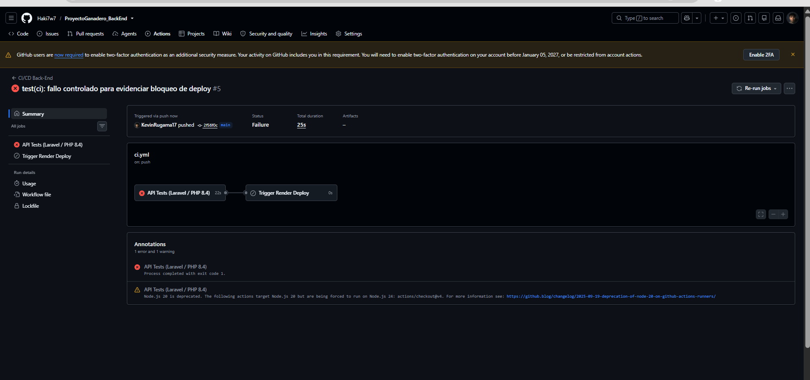
- **Workflow run detenido por fallo (Front-End — PR en `Branch/Kevin`):** `https://github.com/JoelSotela-hub/ProyectoGanadero_FrontEnd/actions/runs/44986558443` *(`Run unit tests`: `failure` → `Build production bundle`: `skipped`)*  
  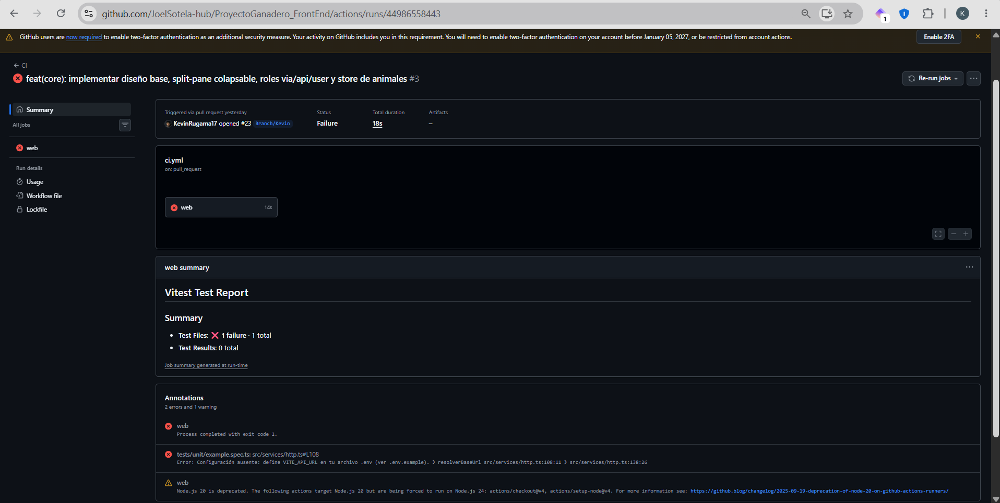

---

## 6. Empaquetado y Publicación de la Aplicación Móvil (`v1.1.0`)

La aplicación móvil comparte el código base Ionic/Vue 3 + Capacitor del repositorio `JoelSotela-hub/ProyectoGanadero_FrontEnd`, apuntando a la misma API de producción en Render:

1. **Compilación de producción y sincronización Android:**
   ```bash
   npm run build
   npx cap sync android
   ```
2. **Firma del paquete de distribución:** Generación del APK `release` (`versionCode 2`, `versionName "1.1.0"`, archivo `guateganado-v1.1.0.apk`) firmado con el almacén de llaves `.jks` resguardado fuera del repositorio mediante `npx cap build android` / Android Studio (`Build → Generate Signed Bundle / APK → APK`).
3. **Autorización CORS para Capacitor:** Los orígenes `http://localhost` (`androidScheme: 'http'` en `capacitor.config.ts`), `https://localhost` (Capacitor HTTPS) y `capacitor://localhost` (iOS) se encuentran registrados y verificados en `CORS_ALLOWED_ORIGINS` en Render.
4. **Publicación:** El APK firmado se publicó en GitHub Releases bajo la etiqueta **`v1.1.0`** para instalación directa en dispositivos físicos durante la defensa.

**Evidencia visual de la publicación móvil:**

- **GitHub Release `v1.1.0` con el APK firmado adjunto:**  
  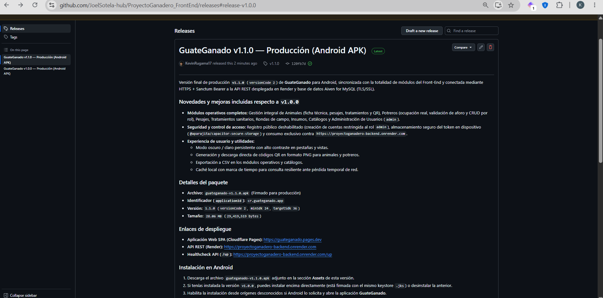
- **App instalada ejecutándose contra la API de producción:**  
  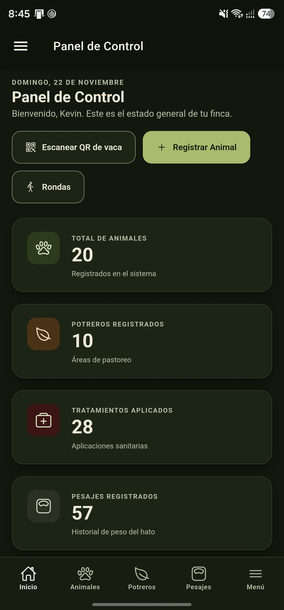

---

## 7. Limitaciones Conocidas y Notas de Operación para la Defensa

- **Arranque en frío de Render:** El servicio gratuito hiberna tras 15 minutos sin tráfico (~60 s de arranque en la primera solicitud). Antes de iniciar la demostración, realizar una petición previa a `/up` para despertar el contenedor.
- **Suspensión de Aiven:** Verificar en la consola de Aiven que el servicio MySQL esté en estado *Running* antes de la defensa.
- **Disco efímero en Render:** No se persisten archivos binarios en `storage/app`; sesiones y caché residen en MySQL y la identificación de animales/potreros utiliza códigos QR generados dinámicamente y descargables en PNG.