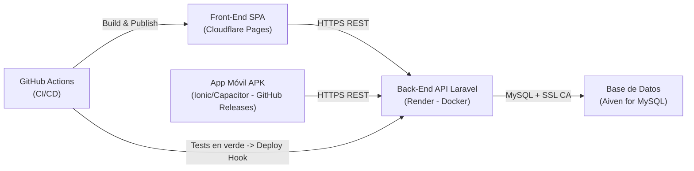

# Lab 14 — Despliegue en Producción (GuateGanado)

## 1. Arquitectura de Despliegue

| Componente | Plataforma / Servicio | Propósito |
| --- | --- | --- |
| **API REST (Back-End)** | Render (Web Service con Docker) | API Laravel sobre PHP 8.4 (`serversideup/php:8.4-fpm-nginx`), puerto `8080`, healthcheck `/up` |
| **Base de Datos** | Aiven for MySQL | MySQL gestionado con TLS/SSL obligatorio (`aiven-ca.pem`) y `sql_require_primary_key = ON` |
| **Front-End Web SPA** | Cloudflare Pages | Aplicación web desplegada en `*.pages.dev` |
| **App Móvil (Android)** | GitHub Releases (APK) | Aplicación Ionic/Capacitor consumiendo la API pública |
| **CI/CD** | GitHub Actions | Ejecución automática de `php artisan test` y disparo de Deploy Hook en Render al hacer `push` a `main` |

---

## 2. Variables de Entorno por Servicio (Sin Secretos)

### Back-End (Render — Web Service)

| Variable | Ejemplo / Valor Referencial | Descripción |
| --- | --- | --- |
| `APP_NAME` | `GuateGanado` | Nombre de la aplicación |
| `APP_ENV` | `production` | Entorno de ejecución (activa validaciones fail-fast) |
| `APP_DEBUG` | `false` | Deshabilita trazas de depuración en producción |
| `APP_KEY` | `base64:<generar-con-artisan>` | Llave de cifrado de Laravel (secreto) |
| `APP_URL` | `https://<servicio>.onrender.com` | URL pública de la API |
| `DB_CONNECTION` | `mysql` | Driver de base de datos |
| `DB_HOST` | `<host>.aivencloud.com` | Host de Aiven for MySQL |
| `DB_PORT` | `<puerto-aiven>` | Puerto de Aiven for MySQL |
| `DB_DATABASE` | `defaultdb` | Nombre de la base de datos |
| `DB_USERNAME` | `<usuario-aiven>` | Usuario de la base de datos (secreto) |
| `DB_PASSWORD` | `<contraseña-aiven>` | Contraseña de la base de datos (secreto) |
| `MYSQL_ATTR_SSL_CA` | `/var/www/html/certs/aiven-ca.pem` | Ruta al certificado CA de Aiven dentro del contenedor |
| `CORS_ALLOWED_ORIGINS` | `https://<app>.pages.dev,https://localhost,capacitor://localhost` | Lista explícita de orígenes permitidos (nunca `*`) |
| `LOG_CHANNEL` | `stderr` | Envío de logs a salida estándar de Render |

### GitHub Actions (Repository Secrets)

| Secreto | Descripción |
| --- | --- |
| `RENDER_DEPLOY_HOOK` | URL del Deploy Hook de Render disparado únicamente tras aprobar el job `api` en `main` |

### Front-End (Cloudflare Pages)

| Variable | Ejemplo / Valor Referencial | Descripción |
| --- | --- | --- |
| `VITE_API_URL` / `API_URL` | `https://<servicio>.onrender.com/api` | URL base de la API en producción |

---

## 3. Seguridad y Contenerización

- **Contenedor Multi-Stage (`Dockerfile`):**
  - **Etapa 1 (`vendor`):** Instala dependencias de producción con `composer install --no-dev --no-scripts --no-autoloader --no-interaction --prefer-dist` y genera autoloader optimizado (`composer dump-autoload --optimize --no-dev`).
  - **Etapa 2 (producción):** Basada en `serversideup/php:8.4-fpm-nginx` con `PHP_OPCACHE_ENABLE=1` y `AUTORUN_ENABLED=true`. Copia únicamente los artefactos necesarios desde `vendor` con `--chown=www-data:www-data`.
  - **Usuario sin privilegios:** El contenedor finaliza y se ejecuta bajo `USER www-data` escuchando en el puerto `8080`.
  - **Contexto limpio (`.dockerignore`):** Excluye `.env`, `.git`, `.github`, `node_modules`, `vendor`, `tests`, `docs`, `backend-aspnet`, `backend-nestjs`, archivos `*.sqlite*`, caches/logs locales y `api.json`.
- **Proxies de confianza:** `$middleware->trustProxies(at: '*')` configurado en `bootstrap/app.php` para interpretar correctamente `X-Forwarded-*` detrás del proxy TLS de Render.
- **CORS restrictivo:** Configurado dinámicamente en `config/cors.php` desde `CORS_ALLOWED_ORIGINS`, prohibiendo comodines (`*`).
- **Falla explícita (Fail-Fast):** En `AppServiceProvider::boot()`, cuando `APP_ENV=production` y no corre en consola, la aplicación lanza `RuntimeException` si faltan `APP_KEY`, `DB_HOST` o `CORS_ALLOWED_ORIGINS`, o si `CORS_ALLOWED_ORIGINS` contiene `*`.
- **SSL obligatorio en BD:** Conexión `mysql` en `config/database.php` configurada con `Mysql::ATTR_SSL_CA` apuntando a `certs/aiven-ca.pem`.
- **Healthcheck:** Endpoint `/up` activo en `bootstrap/app.php`.

---

## 4. Tabla de Tamaños de Artefactos

| Artefacto | Comando de Medición | Tamaño | Notas |
| --- | --- | --- | --- |
| Imagen Docker Back-End (`Dockerfile` multi-stage) | `docker images <nombre-imagen>` | `_Pendiente de medir_` | Imagen final `serversideup/php:8.4-fpm-nginx` sin dev-dependencies |
| Build Front-End (`dist/`) | `du -sh dist/` | `_Pendiente de medir_` | Bundle de producción desplegado en Cloudflare Pages |
| APK Android (Release) | `ls -lh app-release.apk` | `_Pendiente de medir_` | Publicado en GitHub Releases |

---

## 5. Enlaces Públicos

- **API en Producción (Render):** `https://<completar>.onrender.com`
- **Healthcheck API:** `https://<completar>.onrender.com/up`
- **Front-End Web SPA (Cloudflare Pages):** `https://<completar>.pages.dev`
- **Release APK Móvil (GitHub Releases):** `https://github.com/<org>/<repo>/releases/tag/<version>`

---

## 6. Evidencias de CI/CD (GitHub Actions)

### 6.1 Ejecución en Verde (Tests pasando + Deploy a Render)
- **Enlace al workflow run:** `_Pendiente de agregar URL_`
- **Captura de pantalla:**
  > Insertar aquí captura del job `api` en verde y el job `deploy` ejecutado exitosamente en `main`.

### 6.2 Detención en Rojo (Fallo intencional bloqueando el despliegue)
- **Enlace al workflow run:** `_Pendiente de agregar URL_`
- **Captura de pantalla:**
  > Insertar aquí captura del job `api` fallando y el job `deploy` omitido (`skipped`) protegiendo producción.
